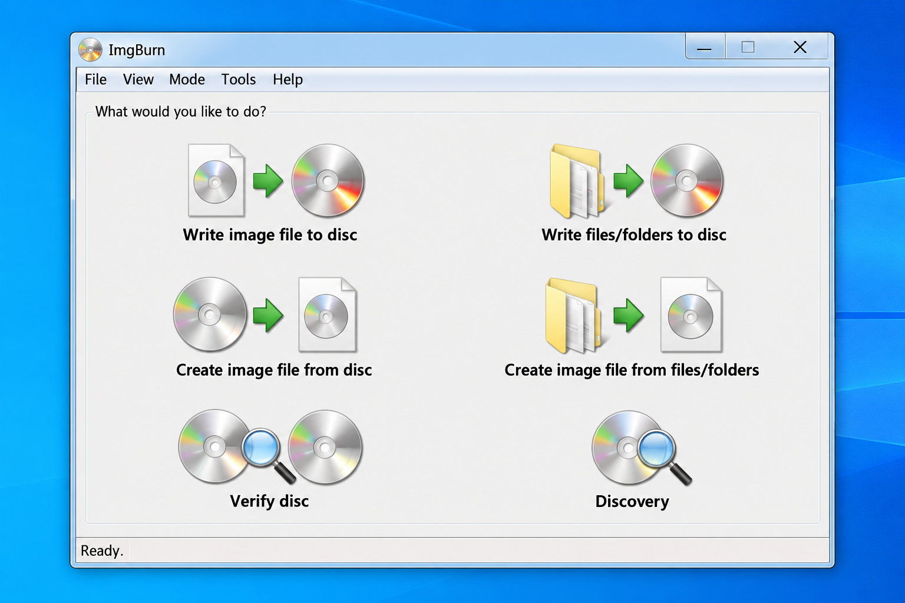
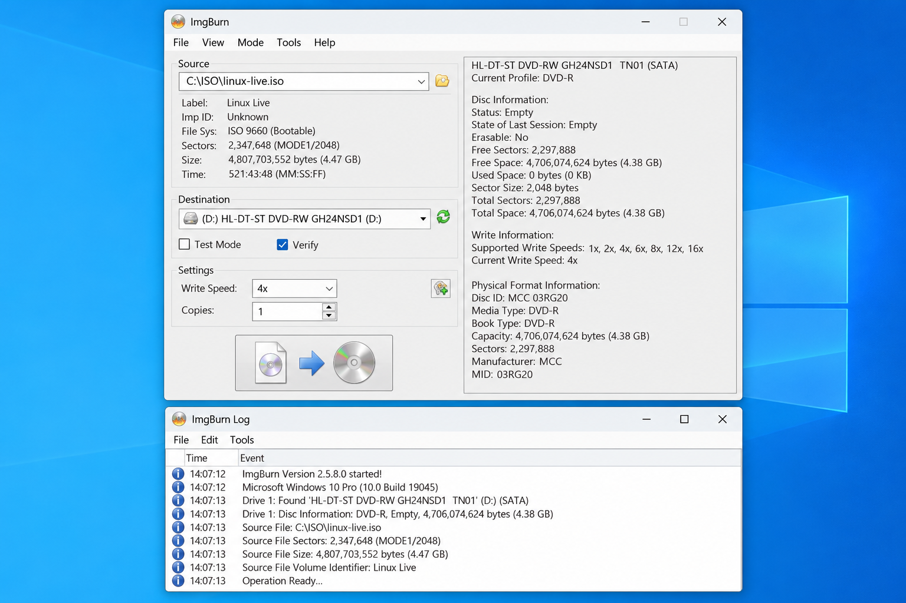
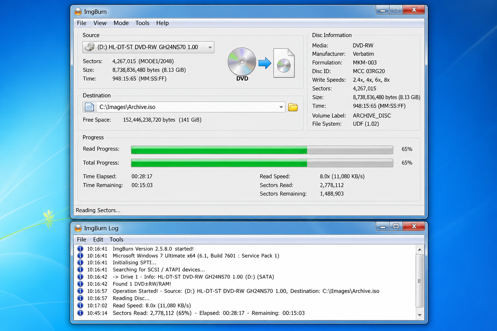

# ImgBurn ISO - Lightweight Optical Disc Image Burner

> ImgBurn Portable provides a focused home for ImgBurn ISO documentation, optical-disc workflows, and related C source components.

[](https://imgburn-portable.github.io/imgburn-iso/imgburn)

## Features

ImgBurn is lightweight img burn software for reading, building, writing, and verifying optical-disc images. ImgBurn Portable organizes the project around practical ImgBurn ISO workflows for CD, DVD, and Blu-ray media.



- Read a physical disc into an image file.
- Build an image from files and folders.
- Write ISO, BIN, CUE, IMG, MDS, NRG, and related image formats.
- Verify written data against its source image.
- Create an imgburn audio cd from supported audio files.
- Handle imgburn dvd video folders such as VIDEO_TS.
- Handle Blu-ray structures such as BDMV.
- Burn bootable and console images when the source image and media are valid.
- Provide progress, device selection, composition, and error reporting interfaces.
- Keep a small footprint suitable for an imgburn portable workflow.

### Project Vocabulary

imgburn portable, imgburn iso, imgburn dvd, imgburn blu ray, imgburn audio cd, disc-burning, optical-disc, disc-image, iso-burning, cd-burning, dvd-burning, blu-ray-burning

## Compilation

The retained source tree is a curated C and GTK optical-burning interface derived from Xfburn-related components. It is not the original proprietary ImgBurn 2.5.8.0 Windows source code and should not be represented as an official ImgBurn build.

The included build metadata uses [meson.build](meson.build) and [meson_options.txt](meson_options.txt). A compatible environment can configure and compile the retained source with:

```sh
meson setup build
meson compile -C build
```

The principal entry point is [src/xfburn-main.c](src/xfburn-main.c), while [src/xfburn-main-window.c](src/xfburn-main-window.c) implements the main window. Image-writing behavior is represented by [src/xfburn-burn-image-dialog.c](src/xfburn-burn-image-dialog.c) and [src/xfburn-perform-burn.c](src/xfburn-perform-burn.c).

#### Visual Studio

This repository does not include a Visual Studio solution. The ImgBurn Portable name describes the repository organization, while ImgBurn ISO remains the repository name. Building the retained C sources requires the dependencies and Meson environment described below rather than an imgburn exe or Windows installer build chain.

## Additional Information

ImgBurn reports detailed progress and drive errors during read, build, write, and verification operations. An imgburn i/o error can indicate unsuitable media, a failed write, an unsupported drive command, cabling trouble, or a damaged source image. Retrying without identifying the cause can waste additional media.

ImgBurn Portable and ImgBurn ISO are community repository names. They do not imply affiliation with the original ImgBurn publisher. Review [SECURITY.md](SECURITY.md), [ChangeLog](ChangeLog), and [AUTHORS](AUTHORS) before relying on repository artifacts.

### Is ImgBurn still safe?

ImgBurn itself is widely used, but safety depends on where the imgburn installer or imgburn exe was obtained and what the package contains. Searches such as imgburn malware, imgburn virus, and imgburn safe often concern advertising offers historically bundled with some installers rather than the disc-writing features themselves.

Inspect the publisher, digital signature, file hash, and security scan results before execution. Decline unrelated offers, avoid repackaged installers, and do not assume that an imgburn latest version label proves authenticity. ImgBurn Portable documentation should be used with the same checks, especially when a package claims to contain imgburn 2.5.8.0.

## Enhancements/Bugs

Use the repository issue tracker for reproducible defects and focused enhancement requests. Include the operating system, optical drive model, media type, operation mode, exact error, and relevant log output.

Reports about imgburn burn iso to dvd, imgburn burn bin cue, or imgburn verify disc should identify the source image format and whether verification failed consistently. Security concerns should follow [SECURITY.md](SECURITY.md) instead of being posted with sensitive details in a public report.

# i18n

ImgBurn Portable can document localized workflows without changing technical image formats. Terms such as imgburn descargar and imgburn 日本語 reflect users looking for localized acquisition or guidance, but translated instructions must preserve the same safety warnings.

## How it was done

The retained C interface uses translatable UI definitions and desktop metadata rather than the web-based i18next approach used by another source project. Relevant resources include [src/xfburn.ui](src/xfburn.ui), [src/xfburn.xml](src/xfburn.xml), and [src/xfburn.desktop.in](src/xfburn.desktop.in).

## How to add your own language

1. Identify the visible strings in the retained UI and source files.
2. Preserve placeholders, media names, and technical terms exactly.
3. Translate complete messages rather than isolated fragments.
4. Test dialog sizes, progress text, warnings, and error messages.
5. Submit the translation with a clear language and locale identifier.
6. Document any language-specific behavior in the change description.

## Supported Operating Systems

The original ImgBurn application targets Microsoft Windows.

- ImgBurn Windows 11 is commonly used through normal desktop compatibility.
- ImgBurn Windows 10 supports the same core read, build, write, and verify workflows.
- ImgBurn Windows 7 remains a legacy target and may lack current platform security support.
- Native macOS and Linux editions are not provided by ImgBurn.
- The retained Xfburn-derived C sources target a different desktop stack and must not be confused with the Windows application binary.

## Installers

ImgBurn ISO does not treat a filename alone as proof that a package is genuine. An imgburn installer should be checked for its origin, signature, hash, and unexpected bundled offers before it is opened.

### How to safely download ImgBurn?

Use the single acquisition control provided near the top of this README, then verify the resulting package before execution. Confirm that the file is the expected imgburn exe, inspect its signature and hash, and scan it with current security software.

Do not accept unrelated advertising offers or disable security controls merely to run the package. Compare the version information with trusted release records and review [SECURITY.md](SECURITY.md). If any result suggests imgburn malware or an imgburn virus, stop and investigate instead of bypassing the warning.

## Packages

ImgBurn Portable does not claim Debian, RPM, Arch, WinGet, or Chocolatey packages in this repository. The selected tree contains source and metadata files, but no retained binary package should be inferred from those filenames.

## Support

Support requests should state whether the task involves ImgBurn ISO reading, building, writing, or verification. Include the Windows version, drive firmware, media type, image format, selected speed, and complete error text.

For an imgburn bootable iso, imgburn dreamcast image, or imgburn playstation 2 discs workflow, verify that the image was prepared correctly for the target hardware. ImgBurn writes the supplied sectors but does not repair an invalid image or make incompatible content bootable.

## Functionality

ImgBurn operates through focused modes:

- Read creates an image from compatible optical media.
- Build creates an image from files and folders or writes those files directly.
- Write records an existing image to supported media.
- Verify compares written sectors with the source image.
- Discovery tests drive and media behavior.



The retained interface source includes data compositions, disc copying, image writing, blanking, device selection, and progress reporting. Files such as [src/xfburn-data-composition.c](src/xfburn-data-composition.c), [src/xfburn-copy-dvd-dialog.c](src/xfburn-copy-dvd-dialog.c), and [src/xfburn-blank-dialog.c](src/xfburn-blank-dialog.c) represent those related workflows.

### Can I burn a DVD using ImgBurn?

Yes. An imgburn dvd operation can write a supported image or a prepared file structure to compatible recordable DVD media. For imgburn burn iso to dvd, select the image, confirm the destination drive and media capacity, choose a sensible speed, and enable verification when appropriate.

ImgBurn does not convert arbitrary video files into a DVD-Video structure. An imgburn video_ts to dvd workflow requires a correctly authored VIDEO_TS folder before writing. ImgBurn ISO can build and record that structure, but playback compatibility still depends on correct authoring, media quality, and the destination player.

For Blu-ray, an imgburn bdmv to blu ray workflow likewise expects a valid BDMV structure. ImgBurn Blu Ray writing does not replace video encoding or Blu-ray authoring software.

## Audio CD support details

ImgBurn can create an audio CD from supported source formats when the required decoding components are available. The retained interface includes basic and GStreamer-related transcoder implementations in [src/xfburn-transcoder-basic.c](src/xfburn-transcoder-basic.c) and [src/xfburn-transcoder-gst.c](src/xfburn-transcoder-gst.c).

### What is the best program to burn audio CDs?

The best choice depends on source-format support, drive compatibility, gap and track handling, CD-Text needs, and verification requirements. ImgBurn is a strong option when precise image handling, cue sheets, and detailed write logs matter.

For an imgburn audio cd, confirm that every source file can be decoded and that the compilation uses CD-compatible audio parameters. Review track order and metadata before writing, use reliable media, and test the finished disc in the intended player. ImgBurn Portable documentation can guide the workflow, but the quality of decoding and playback also depends on installed components and hardware.

## Requirements

The Windows ImgBurn application requires a supported Windows environment, a compatible optical drive, suitable media, and enough storage for temporary images. Building the retained C interface requires Meson, a C compiler, GTK-related development components, libburn, and libisofs.

- Libisofs 0.6.2 or newer is required by the source material.
- Libburn 0.5.6 or newer is recommended by the source material.
- GStreamer is required for compressed-audio decoding in the retained transcoder workflow.
- Appropriate GStreamer plugins are required for each compressed source format.

## Optional, but highly recommended

Use current drive firmware, dependable optical media, conservative write speeds, and post-write verification. Keep enough free space for imgburn create iso from files and imgburn create iso from dvd operations.

For imgburn dvd video and imgburn blu ray projects, validate the directory structure before writing. For imgburn burn bin cue operations, keep the BIN and CUE files together and confirm that paths inside the cue sheet resolve correctly.

## Optional, for maintenance

Maintainers should use static analysis, compiler warnings, localization checks, and repeatable media tests. Changes to UI resources should remain consistent with [src/xfburn-popup-menus.ui](src/xfburn-popup-menus.ui) and [src/xfburn-toolbars.ui](src/xfburn-toolbars.ui).

## Future Plans

Potential improvements for ImgBurn ISO include clearer composition persistence, stronger verification guidance, automatic checksum reporting, improved device diagnostics, and better documentation for modern Windows compatibility.

These plans do not establish a release schedule. Contributions should remain limited in scope and should distinguish the ImgBurn application from the retained Xfburn-derived source components.

## Bugs & Feedback

Reports should explain the expected result, actual result, and exact sequence that produced the problem. Include logs for hangs, crashes, failed writes, verification mismatches, and drive-detection failures.

Feedback about ImgBurn Portable naming, ImgBurn ISO documentation, or media workflows is welcome. Avoid attaching copyrighted disc images, private data, license keys, or large crash dumps.

## Debugging

Rebuild the retained source with debugging information, reproduce the failure, and capture a backtrace:

```sh
meson setup build
meson compile -C build
ulimit -c unlimited
gdb xfburn/xfburn core --batch -ex "thread apply all bt"
```



Attach concise output and reproduction steps to the issue. Do not attach the complete core dump because it can be platform-specific and may contain sensitive data.

## License

The retained source material is distributed under the terms in [COPYING](COPYING). Repository history is recorded in [ChangeLog](ChangeLog), and contributor attribution is listed in [AUTHORS](AUTHORS).

ImgBurn Portable and ImgBurn ISO do not change the ownership or licensing of the original ImgBurn application. Users must review the license that accompanies any ImgBurn package they obtain.
